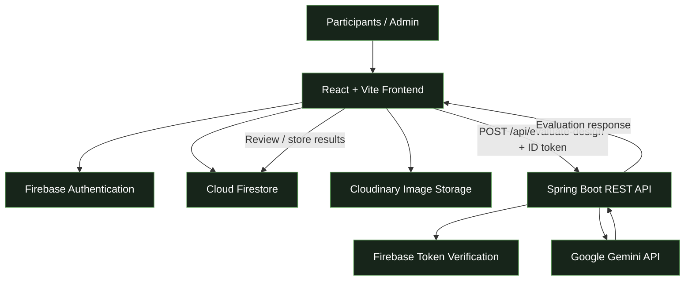

<div align="center">


[](https://artify26.web.app/)
[](https://github.com/Saheera-006/Artify)

<br />


</div>

---

## ✦ About ARTIFY

**ARTIFY** is a full-stack design submission and AI-assisted evaluation platform created for **DYNAMOZ'26**, a symposium organized by the Department of Computer Science and Engineering at **University College of Engineering, Nagercoil**.

Built around **Think. Create. Define.**, ARTIFY supports a two-round creative design competition, bringing submissions, cloud storage, administration, and AI-assisted evaluation into one application.

This version uses a **React + Vite frontend** and a **Java Spring Boot backend**, with Firebase Authentication, Firestore, Cloudinary, and Google Gemini integration.

<div align="center">

| 🎨 Submissions | 🔐 Authentication | 🤖 AI Evaluation | ☁️ Cloud Deployment |
|:---:|:---:|:---:|:---:|
| Design competition workflow | Firebase ID tokens | Gemini via Spring Boot | Firebase Hosting + Render |

</div>

## ✦ Live Application

<div align="center">

### [Open ARTIFY](https://artify26.web.app/)

**Frontend:** [artify26.web.app](https://artify26.web.app/)  
**Admin interface:** [artify26.web.app/admin](https://artify26.web.app/admin)  
**Backend host:** Render (Spring Boot REST API)

</div>

## ✦ Key Features

- **Design submissions** — Collect creative poster and UI design entries.
- **Two-round event workflow** — Organize and evaluate competition submissions.
- **Cloudinary integration** — Store uploaded design images and use their hosted URLs.
- **Firebase Firestore** — Maintain submission and competition data.
- **Firebase Authentication** — Authenticate requests to protected backend functionality.
- **Spring Boot REST API** — Handle server-side AI evaluation requests.
- **Gemini AI evaluation** — Evaluate submitted designs against round-specific criteria.
- **Admin review and re-evaluation** — Review AI feedback and request a fresh evaluation.
- **CSV export** — Export available evaluation information.
- **Production deployment** — React frontend on Firebase Hosting and backend on Render.

## ✦ Technology Stack

<div align="center">


</div>

| Layer | Technology | Responsibility |
|---|---|---|
| Frontend | React, JavaScript, Vite | User and admin interfaces |
| Backend | Java, Spring Boot, Maven | REST endpoints and server-side evaluation |
| Authentication | Firebase Authentication | User identity and ID tokens |
| Database | Cloud Firestore | Application and submission records |
| Image hosting | Cloudinary | Uploaded design assets |
| AI | Google Gemini API | AI-assisted design review |
| Frontend hosting | Firebase Hosting | Production web application |
| Backend hosting | Render | Deployed Spring Boot service |
| Packaging / deployment | Docker | Backend deployment packaging |

## ✦ System Architecture



**Production deployment:** Firebase Hosting serves the frontend; the frontend calls the Spring Boot API hosted on Render. The backend authenticates protected requests and communicates with Gemini without placing the Gemini secret in the frontend bundle.

## ✦ AI Evaluation Flow

1. A participant submits a design through the frontend.
2. The design asset is uploaded to Cloudinary, and submission information is managed in Firestore.
3. An authorized admin requests evaluation or re-evaluation.
4. The frontend sends the submission details and Firebase ID token to `POST /api/evaluate-design`.
5. Spring Boot verifies the request and invokes Google Gemini.
6. The evaluation response is displayed in the admin workflow; available results can be reviewed and exported.

> **AI-assisted scoring should support, not replace, human review.** Evaluation outcomes should be checked for consistency and fairness.

## ✦ Project Structure

The repository is organized around a frontend and a Spring Boot backend. Check the repository for the exact backend module names and paths.

```text
Artify/
├── frontend/                 # React + Vite application
│   ├── src/
│   │   ├── config/           # Frontend configuration
│   │   └── services/         # API integration
│   └── package.json
├── firebase.json             # Hosting / Firebase configuration
├── firestore.rules           # Firestore security rules
├── firestore.indexes.json    # Firestore indexes
└── ...                       # Spring Boot backend and deployment files
```

## ✦ Run Locally

### Prerequisites

- Node.js and npm
- Java (compatible with the backend's `pom.xml`)
- Maven or Maven Wrapper, as configured in the repository
- Firebase project and Cloudinary configuration
- Gemini API credentials **for backend use only**

### 1. Clone the repository

```bash
git clone https://github.com/Saheera-006/Artify.git
cd Artify
```

### 2. Install frontend dependencies

```bash
cd frontend
npm install
```

### 3. Configure the frontend API endpoint

For local development, create `frontend/.env.local` with:

```env
VITE_AI_API_URL=http://localhost:5000
```

The frontend API URL should be read from `import.meta.env.VITE_AI_API_URL`. If the source currently hardcodes the Render URL, update that configuration to support local development before running a local backend.

### 4. Configure and run the backend

Locate the Spring Boot module containing `pom.xml`. Set its required environment variables or private local configuration (without committing secrets):

```env
FIREBASE_PROJECT_ID=your-firebase-project-id
ADMIN_UIDS=your-authorized-admin-uid
ALLOWED_ORIGINS=http://localhost:5173
CLOUDINARY_CLOUD_NAME=your-cloudinary-cloud-name
GEMINI_API_KEY=your-private-gemini-key
```

Run the Spring Boot application from its module using the Maven Wrapper or Maven command appropriate to the project. By default, the backend uses port `5000` unless `PORT` overrides it.

### 5. Start the frontend

```bash
# From the frontend directory
npm run dev
```

Open the local URL printed by Vite.

## ✦ Production Deployment

### Frontend — Firebase Hosting

From the repository root:

```bash
npm --prefix frontend run build
firebase deploy --only hosting --project artify26
```

Set `VITE_AI_API_URL` to the production Render endpoint **before building**, if the frontend reads it from Vite environment variables. Vite embeds these values at build time.

### Backend — Render

The Spring Boot backend is deployed separately to Render. Configure private environment variables in the Render dashboard and redeploy the service when backend changes are pushed.

**Never commit API keys, Firebase service-account JSON, or private configuration files.**

## ✦ Security Notes

- Verify Firebase ID tokens on protected backend endpoints.
- Restrict administrative operations to authorized users.
- Keep Gemini API credentials on the server, not in Vite `VITE_` variables.
- Configure CORS for the exact frontend origin.
- Enforce Firestore security rules and validate uploaded content.
- Avoid logging authentication tokens or secrets.

## ✦ Event Information

| Detail | Information |
|---|---|
| Event | ARTIFY — DYNAMOZ'26 |
| Institution | University College of Engineering, Nagercoil |
| Department | Computer Science and Engineering |
| Format | Two-round design competition |
| Coordinator | Student Event Coordinator |
| Live application | [ARTIFY](https://artify26.web.app/) |

## ✦ Future Enhancements

- Detailed evaluation analytics and dashboards
- More flexible scoring rubrics
- Improved submission status tracking
- Enhanced reporting and exports
- Stronger human review and AI evaluation auditability

## ✦ Project Credits

ARTIFY was developed for the DYNAMOZ'26 design competition. This README describes the **Spring Boot + React deployment** of the project and preserves the original ARTIFY visual identity.

---

<div align="center">

### ARTIFY

**THINK. CREATE. DEFINE.**

*Where creativity meets technology.*

[](https://artify26.web.app/)


</div>
