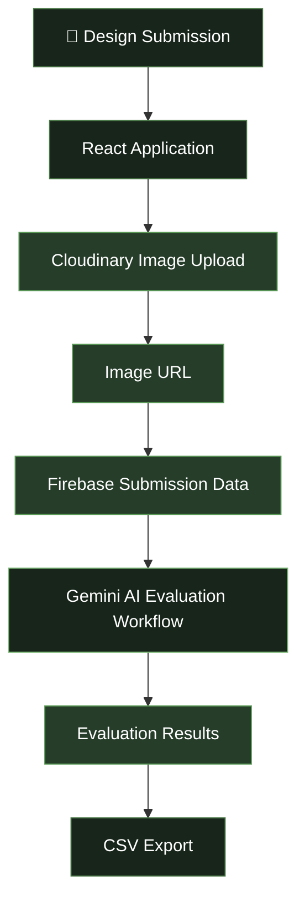

 <div align="center">


<br/>


<br/><br/>

[](https://github.com/Saheera-006/Artify)
[](https://artify26.web.app)

</div>


## ✦ About ARTIFY

**ARTIFY** is an AI-powered design submission and evaluation platform developed for **DYNAMOZ'26**, the symposium organized by the Department of Computer Science and Engineering at University College of Engineering, Nagercoil.

Built around the idea of *Think. Create. Define.*, ARTIFY brings creative design submissions, cloud image storage, and AI-assisted evaluation together in a digital platform.

The application integrates React, Firebase, Cloudinary, and Google Gemini AI to support the design competition workflow.

<div align="center">

| 🎨 Creative Submissions | ☁️ Cloud Storage | 🤖 AI Evaluation |
|:---:|:---:|:---:|
| Digital design workflow | Cloudinary + Firebase | Gemini AI integration |

</div>

## ✦ Highlights

- 🎨 **Design Submissions** — A digital platform for collecting creative entries.
- ☁️ **Cloudinary Integration** — Stores submitted design images in the cloud.
- 🔥 **Firebase Integration** — Stores submission information and associated image URLs.
- 🤖 **Gemini AI Evaluation** — Integrates Google Gemini AI into the design evaluation workflow.
- 📊 **CSV Export** — Supports exporting evaluation data for further analysis.
- 🏆 **Two-Round Event** — Developed for a design competition conducted in two rounds.
- 👩🏻‍💻 **Event Coordination** — The project is connected to my role as Student Event Coordinator for ARTIFY.

## ✦ Tech Stack

<div align="center">


<br/>


</div>

| Technology | Role |
|---|---|
| React | Interactive frontend |
| JavaScript | Application logic |
| Vite | Development and build tooling |
| Firebase | Application data management |
| Cloudinary | Design image storage |
| Google Gemini API | AI-assisted design evaluation |
| CSV | Evaluation data export |

## ✦ How ARTIFY Works



*The diagram represents the overall workflow conceptually; actual request sequencing depends on the implementation.*

### 1. Submit

Participants submit their creative designs through the application.

### 2. Store

Design images are uploaded to Cloudinary, while their image URLs and associated submission details are stored in Firebase.

### 3. Evaluate

Google Gemini AI is integrated into the design evaluation process to support AI-assisted assessment.

### 4. Review and Export

The platform supports reviewing evaluation information and exporting available evaluation data in CSV format.

## ✦ My Role & Contribution

### Student Event Coordinator — ARTIFY

I served as the **Student Event Coordinator for ARTIFY**, a design event conducted across two rounds as part of DYNAMOZ'26.

This experience brought together technology and event execution, connecting the digital submission and evaluation workflow with the practical requirements of organizing a college-level design competition.

- Served as Student Event Coordinator for the ARTIFY event.
- Coordinated an event conducted across two rounds.
- Worked on a platform integrating design submissions, cloud image storage, and AI-assisted evaluation.
- Explored the use of generative AI in a creative competition workflow.

## ✦ Application Preview

<div align="center">

| Design Submission | Administration |
|:---:|:---:|
| Add your submission-page screenshot | Add your admin-page screenshot |
| AI Evaluation | Evaluation Results |
| Add your actual evaluation screenshot | Add your actual results screenshot |

</div>

To display screenshots, create a `screenshots` directory in this repository and replace the descriptions above with Markdown image references to your actual screenshot files.

## ✦ Run Locally

### Prerequisites

- Node.js and npm
- Git
- Firebase project configuration
- Cloudinary account and upload configuration
- Google Gemini API access for the evaluation workflow

### Installation

**1. Clone the repository**

```bash
git clone https://github.com/Saheera-006/Artify.git
```

**2. Open the project directory**

```bash
cd Artify
```

**3. Install dependencies**

```bash
npm install
```

**4. Configure environment variables**

Check the source code for the exact environment variable names and create the required `.env` file.

```env
# Configure the variables required by your application.
# Firebase configuration
# Cloudinary configuration
# Gemini API configuration
```

This is a placeholder template. The variable names must match those used in your project.

**5. Start the development server**

```bash
npm run dev
```

**6. Build the application**

```bash
npm run build
```

Refer to `package.json` for the project's actual scripts and configuration.

## ✦ Security Notes

- Never commit private API keys or service-account credentials.
- Keep privileged Gemini credentials out of publicly accessible frontend code.
- Configure appropriate Firebase Security Rules.
- Validate uploaded files and submitted data.
- Restrict administrative operations to authorized users.

These are recommended practices; check the current implementation to determine which protections are already in place.

## ✦ Future Scope

- Enhanced evaluation analytics and reports.
- More configurable evaluation criteria.
- Improved submission tracking.
- Better administrative reporting.
- Expanded result-export options.
- Additional safeguards for AI-assisted evaluation.

## ✦ Event Details

**Event:** ARTIFY — DYNAMOZ'26

**Department:** Computer Science and Engineering

**Institution:** University College of Engineering, Nagercoil

**Event Format:** Two-round design competition

**My Role:** Student Event Coordinator

## ✦ About the Developer

<div align="center">

### Fathima Saheera J

Aspiring Full Stack Developer · Student Event Coordinator · Technology Enthusiast

A Computer Science and Engineering student interested in building practical applications, exploring emerging technologies, and bringing ideas to life through software development.

[](https://github.com/Saheera-006)

[](https://fathima-saheera.web.app)

</div>

## ✦ License

A license has not been specified. Add a `LICENSE` file if you intend to grant others permission to reuse, modify, or distribute the project.

---

<div align="center">

### ARTIFY

**THINK. CREATE. DEFINE.**

*Where creativity meets technology.*


</div>
