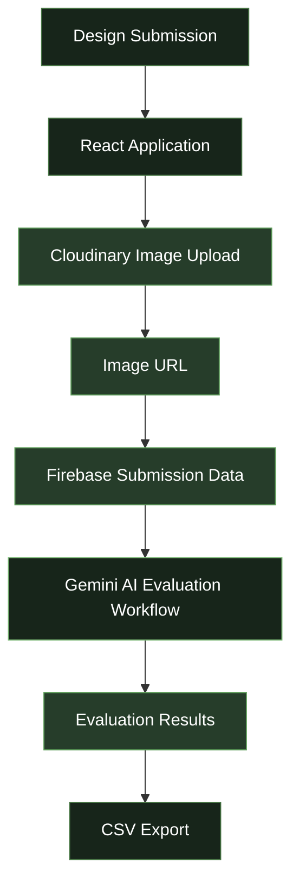

 <div align="center">


<br/>

[](https://artify26.web.app/)
[](https://github.com/Saheera-006/Artify)

<br/>


</div>


## ✦ About ARTIFY

**ARTIFY** is an AI-powered design submission and evaluation platform developed for **DYNAMOZ'26**, the symposium organized by the Department of Computer Science and Engineering at University College of Engineering, Nagercoil.

Built around the idea of *Think. Create. Define.*, ARTIFY brings creative design submissions, cloud image storage, and AI-assisted evaluation together in one digital platform.

The application integrates React, Firebase, Cloudinary, and Google Gemini AI to support the design competition workflow.

The ARTIFY event was conducted across **two rounds**, and I served as its **Student Event Coordinator**.

<div align="center">

| 🎨 Creative Submissions | ☁️ Cloud Storage | 🤖 AI Evaluation |
|:---:|:---:|:---:|
| Digital design workflow | Cloudinary + Firebase | Gemini AI integration |

</div>

## ✦ Live Application

<div align="center">

### Experience ARTIFY

Explore the deployed design competition platform.

[](https://artify26.web.app/)

**Live URL:** https://artify26.web.app/

</div>

## ✦ Highlights

- 🎨 **Design Submissions** — A digital platform for collecting creative entries.
- ☁️ **Cloudinary Integration** — Stores submitted design images in the cloud.
- 🔥 **Firebase Integration** — Stores submission information and associated image URLs.
- 🤖 **Gemini AI Evaluation** — Integrates Google Gemini AI into the design evaluation workflow.
- 📊 **CSV Export** — Supports exporting evaluation data for further analysis.
- 🏆 **Two-Round Event** — Supports the design competition workflow conducted across two rounds.
- 👩🏻‍💻 **Event Coordination** — I served as Student Event Coordinator for ARTIFY.

## ✦ Tech Stack

<div align="center">


<br/><br/>


</div>

| Technology | Purpose |
|---|---|
| React | Frontend user interface |
| JavaScript | Application logic |
| Vite | Development and build tooling |
| Firebase | Application data management |
| Cloudinary | Design image storage |
| Google Gemini API | AI-assisted design evaluation |
| CSV | Evaluation data export |

## ✦ System Architecture



*This diagram illustrates the main components conceptually. The actual request flow depends on the implementation.*

### How It Works

1. **Submit:** Participants submit their creative designs through the application.
2. **Store:** Design images are uploaded to Cloudinary.
3. **Save:** The image URLs and associated submission information are stored in Firebase.
4. **Evaluate:** Google Gemini AI is integrated into the design evaluation workflow.
5. **Review:** Evaluation information can be reviewed through the application's administrative workflow.
6. **Export:** Available evaluation data can be exported in CSV format.

## ✦ My Role & Contribution

### Student Event Coordinator — ARTIFY

I served as the **Student Event Coordinator for ARTIFY**, a design competition conducted across two rounds as part of DYNAMOZ'26.

This experience brought together technology and event execution, connecting the digital submission and evaluation workflow with the practical requirements of conducting a college-level design competition.

**Key highlights:**

- Served as Student Event Coordinator for ARTIFY.
- Coordinated an event conducted across two rounds.
- Worked on a platform integrating design submissions, cloud image storage, and AI-assisted evaluation.
- Contributed to bringing technology into a creative competition workflow.


## ✦ Run Locally

### Prerequisites

- Node.js and npm
- Git
- Firebase project configuration
- Cloudinary account and upload configuration
- Google Gemini API access for the evaluation workflow

### 1. Clone the Repository

```bash
git clone https://github.com/Saheera-006/Artify.git
```

### 2. Navigate to the Project

```bash
cd Artify
```

### 3. Install Dependencies

```bash
npm install
```

### 4. Configure Environment Variables

Inspect the source code for the exact variable names required by Firebase, Cloudinary, and Gemini. Create the required `.env` file in the appropriate directory.

```env
# Add the actual variable names expected by your application.
# Firebase configuration
# Cloudinary configuration
# Gemini API configuration
```

This is a placeholder template. The variable names must match those referenced in the source code.

**Security note:** Never commit private API keys, service-account credentials, or other secrets to GitHub. Privileged API credentials should not be exposed in public frontend code.

### 5. Start the Development Server

For a Vite-based application:

```bash
npm run dev
```

Open the local URL displayed in the terminal.

### 6. Build for Production

```bash
npm run build
```

Check `package.json` for the project's actual scripts and build configuration.

## ✦ Security Considerations

- Keep private API keys and service-account credentials out of source control.
- Avoid exposing privileged Gemini API credentials in public frontend code.
- Configure appropriate Firebase Security Rules.
- Validate uploaded files and submitted data.
- Protect administrative operations with suitable authorization.

These are recommended practices; check the actual implementation to determine which protections are already in place.

## ✦ Future Enhancements

- Enhanced evaluation analytics and reports.
- Configurable evaluation criteria and scoring.
- Improved submission tracking and status visibility.
- Better administrative reporting.
- Expanded result-export options.
- Additional safeguards and human review for AI-assisted evaluation.

## ✦ Event Details

| Detail | Information |
|---|---|
| Event | ARTIFY — DYNAMOZ'26 |
| Department | Computer Science and Engineering |
| Institution | University College of Engineering, Nagercoil |
| Event Format | Two-round design competition |
| My Role | Student Event Coordinator |
| Live Website | [artify26.web.app](https://artify26.web.app/) |

## ✦ About the Developer

<div align="center">

### Fathima Saheera J

**Aspiring Full Stack Developer · Student Event Coordinator · Technology Enthusiast**

A Computer Science and Engineering student interested in building practical applications, exploring emerging technologies, and bringing ideas to life through software development.

<br/>

[](https://github.com/Saheera-006)

[](https://fathima-saheera.web.app)

</div>

## ✦ License

A license has not been specified. Add a `LICENSE` file if you intend to grant others permission to reuse, modify, or distribute this project.

---

<div align="center">

### ARTIFY

**THINK. CREATE. DEFINE.**

*Where creativity meets technology.*

[**Visit the Live Website →**](https://artify26.web.app/)


</div>
